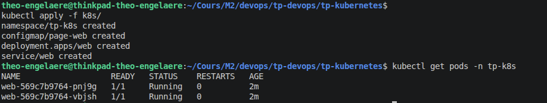
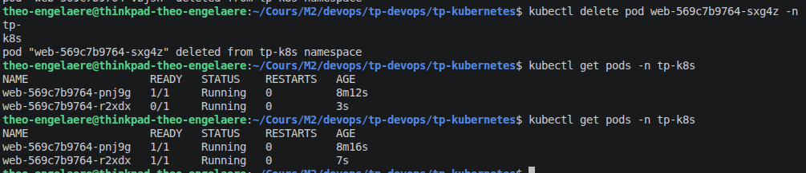
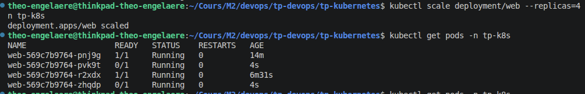
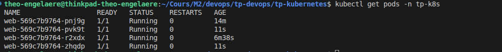
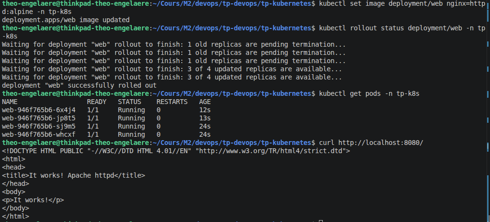
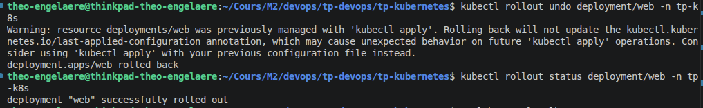
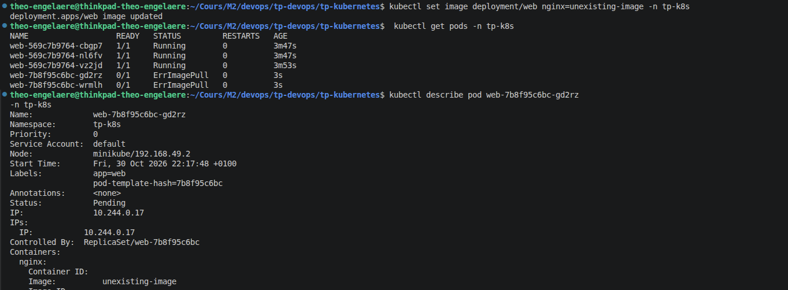

# TP Kubernetes

Le rapport est divisé en 3 parties :

- [Réponses aux questions au cours du TP](#réponses-aux-questions)
- [Mini-projet](#mini-projet)
- [Conclusion](#conclusion)

## Réponses aux questions

### Partie 1 — Explorer l’architecture Kubernetes

#### 1. Questions

1. **Quel est le rôle du control plane ?**

   Son rôle est d'administrer le cluster. Il reçoit les commandes kubectl et applique les changements a autres noeuds.

2. **Quelle différence existe-t-il entre un nœud Kubernetes et un Pod ?**

   Un noeud Kubernetes est la machine virtuelle qui fournit les coeurs CPU et la RAM. Un pod est un élèment hebergé sur le noeud et qui contient un ou plusieurs conteneurs.

3. **Quel contrôleur maintient le nombre de réplicas demandé par un Deployment ?**

   C'est le ReplicaSet qui vérifie rérgulièrement que le nombre de réplicas correspond au nombre demandé par le Deployment.

4. **Quelle différence existe-t-il entre un conteneur et un Pod ?**

   Un conteneur contient une application et ses dépendances. Un pod est un élèment qui heberge un ou plusieurs de ces conteneurs.

5. **Quelles limites présente un cluster local à un seul nœud par rapport à un cluster de production ?**

   Dans un cluster à un noeud, les applications ne fonctionneront plus si le noeud tomba en panne. Les ressources / performances de calculs sont aussi limités par ce qui est alloué au noeud.

#### 2. Réalisez un schéma simple du cluster local et expliquez le rôle des composants que vous avez identifiés.

```
Machine hôte
    |
    |---Noeud Kubernetes
              |
              |----Control Pane :
              |          Reçoit les commandes kubectl
              |          et administre les pods
              |
              |----Worker Node
                        |
                        |----Pod 1
                        |       |-----Conteneur 1
                        |       |         |-----Application
                        |       |
                        |       |-----Conteneur 2
                        |       |          |....
                        |       |...
                        |
                        |----Pod 2
                        |       | .....
                        |
                        |....
```

### Partie 2 — Déployer une application web

#### 1. Créer un namespace

**Question 2.** **Quel intérêt présente un namespace dans un environnement partagé entre plusieurs équipes ?**

Un namespace permets aux équipe de créer des application qui porte le même nom, et permets de mettre des quotas de RAM / CPU.

#### 2. Créer une page web avec une ConfigMap

**Question 3.** **Pourquoi utiliser une ConfigMap plutôt que d’intégrer directement la page dans le manifeste du Deployment ?**

Pour pouvoir modifier le contenu de la page sans avoir à reconstruire l'image.

#### 3. Questions

1. **Quel est le rôle du Deployment par rapport au ReplicaSet ?**

   Le ReplicaSet vérifie le bon fonctionnement des pods, et le Deployment gère les mises à jours.

2. **Pourquoi ne pas accéder directement aux adresses IP des Pods ?**

   Car les pods sont éphémères, et leur adresse IP change quand ils sont recréés.

3. **Quelle différence existe-t-il entre `ClusterIP`, `NodePort` et `LoadBalancer` ?**

   ClusterIs rend l'application visible uniquement depuis l'intérieur du cluster, NodePort ouvre un port sur la machine hôte pour accéder à l'application depuis l'extérieur, et LoadBalancer utilise un cloud pour exposer l'application sur internet.

4. **Quelle différence existe-t-il entre une readiness probe et une liveness probe ?**

   Le readiness probe indique si un pod est prêt à recevoir les requêtes extérieures, et la liveness indique si le pod est bien en vie ou si il a besoin d'être recréé.

5. **Que peut-il se passer si une limite mémoire est trop basse ?**

   Si l'application consomme plus de mémoire que le quota attribué, le processus de l'application et arrêté de force et son conteneur est détruit avant d'être recréé. Un limite mémoire trop basse provoquera trop souvent cela.

### Partie 3 — Résilience et auto-rétablissement (40 min)

1. **Pourquoi le Pod supprimé est-il remplacé ?**

   Car le ReplicaSet surveille en permanence qu'il y a bien le nombre de pods demandés en vie. Si un pod est supprimé, il enclenche la création d'un nouveau immédiatement.

2. **Quelle différence existe-t-il entre la suppression d’un Pod et l’arrêt d’un processus dans un conteneur ?**

   Supprimer un pod détruit tout l'élèment et ses propriété, comme son adresse IP. Arrêter un pod ne le détruit pas et il conserve toutes les données au redémarrage.

3. **Pourquoi un redémarrage de conteneur ne signifie-t-il pas nécessairement que le cluster entier est en panne ?**

   Car un conteneur peut redémarrer à cause d'un bug venant de l'application qu'il héberge, indépendant des autres conteneurs.

4. **Que se passerait-il si le nœud unique de Minikube devenait indisponible ?**

   Plus aucun pods ne serait accessible car il n'y a pas de relais pour le noeud de Minikube.

5. **Pourquoi un cluster local à un seul nœud ne permet-il pas de démontrer la tolérance à la panne d’un nœud physique ?**

   Car si le noeud devient indisponible / tombe en panne, alors tous les pods deviennent inaccessible. L'intérêt de Kubernetes est d'avoir plusieurs noeuds pour transférer les pods d'un noeud qui tombe en panne vers un noeud sain.

### Partie 4 — Mise à l’échelle et découverte de services

1. **Quelle différence existe-t-il entre la mise à l’échelle manuelle et l’autoscaling ?**

   La mise à l'échelle manuelle nécessite qu'un humain tape la commande pour changer le nombre de pods, alors que l'autoscaling change le nombre de pods automatiquement en fonction du traffic de requêtes et de la consomation CPU.

2. **Quel est le rôle d’un Horizontal Pod Autoscaler (HPA) ?**

   Il observe les performances et augmente / diminue automatiquement le nombre de pods.

3. **Pourquoi un HPA basé sur le CPU nécessite-t-il des métriques et des ressources correctement configurées ?**

   Car le HPA prend ses décisions en se basant sur le pourcentage de consomation CPU par rapport à la limite fixé. Si il n'y a pas de limites, le HPA ne déclenchera pas d'autoscaling.

4. **Pourquoi quatre réplicas sur un seul nœud ne garantissent-ils pas la disponibilité en cas de panne de ce nœud ?**

   Car si le noeud tombe en panne, tout les pods qu'il contient deviennent indisponible.

### Partie 5 — Mise à jour et retour arrière

1. **Que signifie la stratégie `RollingUpdate` ?**

   C'est une stratégie de mise à jour des pods où pour chaque pod (un à la fois), un nouveau pod mis à jour est démarré puis seulement quand ce nouveau pod est prêt, supprimer l'ancien pod. Cela permets de garder le service disponible, plutôt que de couper et mettre à jour tous les pods en même temps, qui mettrais en pause le service.

2. **Pourquoi une mise à jour progressive ne garantit-elle pas, à elle seule, une disponibilité parfaite ?**

   Le risque est que la nouvelle version de l'application contiennent un bug. Car Kubernetes supprime les anciens pods avant de savoir si les nouveaux fonctionnent correctement.

3. **Dans quelles conditions `rollout undo` fonctionne-t-il ?**

   Il ne fonctionne que pour annuler des modifications faites sur le Deployment, pas pour des modifications sur une ancienne ConfigMap pas exemple.

4. **Pourquoi faut-il versionner les configurations et planifier les migrations de base de données séparément ?**

   Car la base de données peut changer de schéma entre plusieurs versions. Si les pods et la base sont mis à jour, après un undo l'application reviendra en arrière mais pas le schéma de la base, et l'application ne pourras plus lire la base correctement.

### Partie 6 — Diagnostic et dépannage

Pour chaque incident, suivez une démarche structurée : **symptôme → hypothèse → diagnostic → correction → vérification**.

#### Incident A — Image introuvable

- **Quel état observez-vous ?**

  Un nouveau pod a été créé, d'abors avec le status ImagePullBackOff puis ErrImagePull.

- **Quel événement indique la cause probable ?**

  Dans la liste des events : "failed to pull and unpack image docker.io/library/unexistingimage:latest [...]"

- **Comment corriger le manifeste et vérifier le retour à la normale ?**

  Il faut réappliquer la bonne config : `kubectl apply -f k8s/03-deployment.yaml`, puis vérifier que les pods sont bien en état running.

#### Incident B — Service inaccessible

- **Pourquoi le Service n’a-t-il plus de destination exploitable ?**

  Car le service identifie les pods grâce à son selector. Si l'étiquette d'un pod change mais que le selector n'est pas mis à jour, alors le service ne trouvera plus le pod.

- **Pourquoi les Pods peuvent-ils être opérationnels alors que l’application est inaccessible via le Service ?**

  L'application peut très bien tourner à l'intérieurs des pods, même si la communication entre les pods et le service est coupées, mais alors plus aucun traffic réseau ne leur est envoyé.

- **Quelle correction permet de rétablir le routage ?**

  Il faut remettre le selector du service pour qu'il corresponde bien à la sections labels dans le Deployment -> labels.

#### Incident C — Sonde de santé incorrecte

- **Quel est l’effet d’une readiness probe en échec ?**

  L'état du pod est bien Running mais READY n'est pas activé (0/1). Le service coupe alors la connextion avec lui.

- **En quoi son effet diffère-t-il de celui d’une liveness probe en échec ?**

  Si une readiness échoue, cela isole le pod du réseau sans détruire de conteneur, alors que si une liveness échoue, le conteneur est détruit et recréé.

- **Pourquoi une sonde mal configurée peut-elle provoquer une indisponibilité ?**

  Car une erreur d'URL au niveau de la sonde fera passer le conteneur comme en panne alors que l'application peut très bien tourner. Si cela arrive dans tout les pods, cela va provoquer une panne générale.

## Mini-projet

### Architecture

- [x] Déployer une application avec au moins deux réplicas.
- [x] Créer un namespace et un Service dédiés.
- [x] Configurer des probes de santé.
- [x] Définir des requests et des limits CPU/mémoire.

Voir fichiers de manifeste dans le répertoire [k8s/](k8s) (namespace, configmap, deployment et service).

Application de l'architecture :

```bash
$ kubectl apply -f k8s/

namespace/tp-k8s created
configmap/page-web created
deployment.apps/web created
service/web created


$:kubectl get pods -n tp-k8s

NAME                   READY   STATUS    RESTARTS   AGE
web-569c7b9764-pnj9g   1/1     Running   0          2m
web-569c7b9764-vbjsh   1/1     Running   0          2m
```



### Remplacement d'un pod supprimé

- [x] Démontrer le remplacement automatique d’un Pod supprimé.

Suppression d'un pod avec `kubectl delete pod web-569c7b9764-vbjsh -n tp-k8s` et observation de la création d'un nouveau pod avec `kubectl get pods -n tp-k8s` :

```bash
$ kubectl delete pod web-569c7b9764-sxg4z -n tp-k8s

pod "web-569c7b9764-sxg4z" deleted from tp-k8s namespace

$ kubectl get pods -n tp-k8s

NAME                   READY   STATUS    RESTARTS   AGE
web-569c7b9764-pnj9g   1/1     Running   0          8m12s
web-569c7b9764-r2xdx   0/1     Running   0          3s

$ kubectl get pods -n tp-k8s

NAME                   READY   STATUS    RESTARTS   AGE
web-569c7b9764-pnj9g   1/1     Running   0          8m16s
web-569c7b9764-r2xdx   1/1     Running   0          7s
```



### Mise à l'échelle manuelle

- [x] Réaliser une mise à l’échelle manuelle.

Forcage du passage à 4 réplicas avec `kubectl scale deployment/web --replicas=4 -n tp-k8s` :

```bash
$ kubectl scale deployment/web --replicas=4 -n tp-k8s

deployment.apps/web scaled

$ kubectl get pods -n tp-k8s

NAME                   READY   STATUS    RESTARTS   AGE
web-569c7b9764-pnj9g   1/1     Running   0          14m
web-569c7b9764-pvk9t   0/1     Running   0          4s
web-569c7b9764-r2xdx   1/1     Running   0          6m31s
web-569c7b9764-zhqdp   0/1     Running   0          4s

$ kubectl get pods -n tp-k8s

NAME                   READY   STATUS    RESTARTS   AGE
web-569c7b9764-pnj9g   1/1     Running   0          14m
web-569c7b9764-pvk9t   1/1     Running   0          11s
web-569c7b9764-r2xdx   1/1     Running   0          6m38s
web-569c7b9764-zhqdp   1/1     Running   0          11s
```




### Mise à jour et retour en arrière

- [x] Effectuer une mise à jour puis un retour arrière.

Mise à jour : modification de l'image pour passer de nginx à httpd, avec `kubectl set image deployment/web nginx=httpd:alpine -n tp-k8s`

```bash
$ kubectl set image deployment/web nginx=httpd:alpine -n tp-k8s
deployment.apps/web image updated

$ kubectl rollout status deployment/web -n tp-k8s
Waiting for deployment "web" rollout to finish: 1 old replicas are pending termination...
Waiting for deployment "web" rollout to finish: 1 old replicas are pending termination...
Waiting for deployment "web" rollout to finish: 1 old replicas are pending termination...
Waiting for deployment "web" rollout to finish: 3 of 4 updated replicas are available...
Waiting for deployment "web" rollout to finish: 3 of 4 updated replicas are available...
deployment "web" successfully rolled out

$ kubectl get pods -n tp-k8s
NAME                  READY   STATUS    RESTARTS   AGE
web-946f765b6-6x4j4   1/1     Running   0          12s
web-946f765b6-jp8t5   1/1     Running   0          13s
web-946f765b6-sj9m5   1/1     Running   0          24s
web-946f765b6-whcxf   1/1     Running   0          24s

$ curl http://localhost:8080/
....
<p>It works!</p>
....
```



Après ce changement, la page web n'affiche plus la page initiales mais affiche la page par défaut de httpd ("it works!"), car le fichier html créer au montage de l'architecture a été placé dans le répertoire spécifique pour nginx.

Retour en arrière avec `kubectl rollout undo deployment/web -n tp-k8s`:

```bash
$ kubectl rollout undo deployment/web -n tp-k8s

Warning: resource deployments/web was previously managed with 'kubectl apply'. Rolling back will not update the kubectl.kubernetes.io/last-applied-configuration annotation, which may cause unexpected behavior on future 'kubectl apply' operations. Consider using 'kubectl apply' with your previous configuration file instead.
deployment.apps/web rolled back

$ kubectl rollout status deployment/web -n tp-k8s

deployment "web" successfully rolled out
```



### Provoquer et diagnostiquer un incident

- [x] Provoquer et diagnostiquer un incident.

Demande de changement pour une image qui n'existe pas avec `kubectl set image deployment/web nginx=unexisting-image -n tp-k8s`, puis diagnostic en analysant un des pod en panne :

```bash
$ kubectl set image deployment/web nginx=unexisting-image -n tp-k8s

deployment.apps/web image updated

$  kubectl get pods -n tp-k8s
NAME                   READY   STATUS         RESTARTS   AGE
web-569c7b9764-cbgp7   1/1     Running        0          3m47s
web-569c7b9764-nl6fv   1/1     Running        0          3m47s
web-569c7b9764-vz2jd   1/1     Running        0          3m53s
web-7b8f95c6bc-gd2rz   0/1     ErrImagePull   0          3s
web-7b8f95c6bc-wrmlh   0/1     ErrImagePull   0          3s

$ kubectl describe pod web-7b8f95c6bc-gd2rz  -n tp-k8s
Name:             web-7b8f95c6bc-gd2rz
Namespace:        tp-k8s
Priority:         0
Service Account:  default
[...]
Containers:
  nginx:
    Container ID:
    Image:          unexisting-image
    [...]
Conditions:
  Type                        Status
  PodReadyToStartContainers   True
  Initialized                 True
  Ready                       False
  ContainersReady             False
  PodScheduled                True
[...]
Events:
  Type     Reason     Age                From               Message
  ----     ------     ----               ----               -------
  Normal   Scheduled  26s                default-scheduler  Successfully assigned tp-k8s/web-7b8f95c6bc-gd2rz to minikube
  Normal   BackOff    24s                kubelet            spec.containers{nginx}: Back-off pulling image "unexisting-image"
  Warning  Failed     24s                kubelet            spec.containers{nginx}: Error: ImagePullBackOff
  Normal   Pulling    10s (x2 over 25s)  kubelet            spec.containers{nginx}: Pulling image "unexisting-image"
  Warning  Failed     10s (x2 over 24s)  kubelet            spec.containers{nginx}: Failed to pull image "unexisting-image":failed to pull and unpack image "docker.io/library/unexisting-image:latest": failed to resolve reference "docker.io/library/unexisting-image:latest": pull access denied, repository does not exist or may require authorization: server message: insufficient_scope: authorization failed
  Warning  Failed     10s (x2 over 24s)  kubelet            spec.containers{nginx}: Error: ErrImagePull
```



Les infos sur le pod et ses évènements indiquent bien les erreurs ImagePullBackOff et ErrImagePull, avec les messages expliquant l'échec de la récupération de l'image ("Failed to pull image...", "repository does not exist or may require authorization...").

Résolution : réappliquer la bonne image avec `kubectl set image deployment/web nginx=nginx:stable-alpine -n tp-k8s` ou réappliquer le Deployment avec `kubectl apply -f k8s/03-deployment.yaml`

## Conclusion

> En quoi Kubernetes apporte-t-il des mécanismes d’orchestration qui dépassent la simple exécution de conteneurs avec Docker, et quelles précautions restent nécessaires pour exploiter une application de manière fiable en production ?

Kubernetes permet l'automatisation poussée de la gestion des conteneurs Docker. Il permet de les organiser en pods qui hébergent les réplicas de l'application, et le trafic des requêtes est réparti entre eux. Kubernetes maintient le nombre de réplicas demandé, recrée automatiquement les pods en cas de panne et permet de répartir les applications sur plusieurs machines. Le Service de Kubernetes permet un accès simple aux pods, alors que leurs adresses IP sont différentes pour chacun et change à chaque recréation de pod. Gérer manuellement des conteneurs Docker de cette manière serait extrêmement fastidieux.

Pour cela, la configuration doit bien correspondre aux besoins et aux contraintes, notamment sur le nombre de réplicas et sur les limites CPU et RAM. Les mises à jour doivent aussi être bien configurées pour éviter les interruptions de service. Pour la production, il est important de déployer plusieurs noeuds pour maintenir l'application disponible si l'une des machines tombe en panne.
